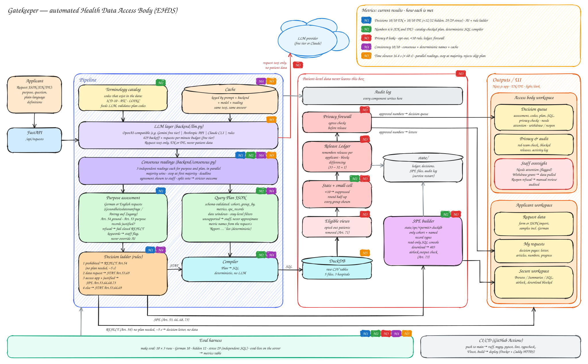

# Gatekeeper: an automated Health Data Access Body

Gatekeeper decides requests for European Health Data Space (EHDS) data in seconds. It reads an applicant's request, decides whether the purpose is allowed under Regulation (EU) 2025/327, explains the decision in plain language with the articles it relies on, and then either computes privacy-protected statistics or opens a secure workspace with the selected records, from which nothing can be downloaded. Staff of the access body review every decision in their own workspace.

Built for Track 3 of the hackathon. The original track brief is in [docs/TRACK.md](docs/TRACK.md).

## The problem

The EHDS lets researchers, public bodies and companies reuse health data, but every request has to be decided by a national **Health Data Access Body (HDAB)**. Today that work is manual:

- **Slow decisions.** A case officer reads the request, checks the purpose against the law, translates plain-English definitions ("type 2 diabetes", "active anticoagulant") into codes (ICD-10, ATC, LOINC), writes the queries and checks the output for privacy.
- **Fragile privacy.** Opted-out patients must be left out everywhere, and small groups must be hidden. Even then, two harmless-looking answers can be subtracted to reveal one patient: the small-cell rule checks each answer alone.
- **Hard to understand.** Applicants receive legal decisions they cannot easily act on, for example why they got statistics instead of the records they asked for.
- **Prohibited uses.** Insurers, employers, marketers and makers of harmful products must be refused (Art. 54), even when the request is worded innocently.

## Our solution

Gatekeeper automates the access body's routine work and leaves the judgement calls visible to staff.

1. **Decide.** The request is read for its purpose and checked against Art. 54 (prohibited) and Art. 53 (allowed). The decision follows the brief's order: `REJECT` (Art. 54), `APPROVE_STATISTICAL` (Art. 53, 69), `APPROVE_SPE` when an access application explains why statistics are not enough (Art. 53, 66, 68, 73), otherwise statistics instead of records (Art. 53, 66, 69).
2. **Compute statistics safely.** Definitions become a typed query plan; deterministic code computes the numbers. Every requested group is shown; counts below 10 become `<10`; percentages and means over fewer than 10 patients become `suppressed`; values are rounded to one decimal, halves up. Opted-out patients are removed before any query can see them.
3. **Open a secure workspace.** For approved record access, only the selected patients and the requested record types are copied into a separate database per data permit. Researchers can query it; downloads are blocked (403), and only aggregate results checked for small cells can leave through an airlock.
4. **Stop differencing attacks.** A release ledger remembers what each applicant has already received and withholds an answer that, combined with an earlier one, would reveal fewer than 10 patients.
5. **Explain and review.** Applicants get a plain-language decision letter with the legal basis. Staff get the AI assessment, how many independent readings agreed, the code mappings, the plan, the SQL and the privacy checks. Decisions are issued immediately. Staff are alerted only to cases that need attention, where the AI was unsure or flagged something. With a reason, they can withdraw a grant, which pulls the released statistics or closes the secure workspace, or reopen a refusal for manual review. Both actions are stored and audited.

The design rule: **AI reads the request; code computes the answer.** The language model only sees request text, never patient data, and never writes SQL.

## Architecture



Editable source: [docs/architecture.excalidraw](docs/architecture.excalidraw), which opens on excalidraw.com or in the VS Code Excalidraw extension.

**Request flow:** request JSON → 3 parallel readings of the purpose and 3 of the definitions (LLM, request text only) → majority vote → decision ladder → compiler (plan → SQL) → DuckDB views without opted-out patients → statistics with the small-cell rule → release ledger → privacy firewall → decision letter. Approved record access goes to the secure-workspace builder instead. Rejections return without waiting for a plan.

| Component | File | What it does |
|---|---|---|
| Configuration | [backend/config.py](backend/config.py), [.env.example](.env.example) | Typed settings from environment variables or a `.env` file. |
| LLM layer | [backend/llm.py](backend/llm.py) | Structured JSON output from any OpenAI-compatible endpoint (free tiers such as Gemini or Groq), the Anthropic API, or the local `claude` CLI. Failed or malformed answers are retried once. A disk cache keyed by prompt, backend, model and reading means the same request always gets the same reading. |
| Consensus | [backend/consensus.py](backend/consensus.py), [backend/pipeline.py](backend/pipeline.py) | 3 independent readings of the purpose and of the definitions run in parallel, and the majority wins. Plans are compared by the exact values they would release. Waiting stops at the first majority, with a hard deadline. |
| Purpose assessment | [backend/decide.py](backend/decide.py) | The LLM judges the Art. 54 ground, the Art. 53 purpose, and whether records are justified. Keywords linked to prohibited uses only add a staff review flag; they never override the AI, because they can't read context ("tobacco control" is public health). They decide alone only when no LLM is available. A model refusal rejects the request and flags it for staff. |
| Decision ladder | [backend/decide.py](backend/decide.py), [backend/law.py](backend/law.py) | Deterministic rules turn the assessment into the decision, articles and plain-language reason. |
| Terminology catalog | [backend/terminology.py](backend/terminology.py) | Lists the ICD-10, ATC and LOINC codes that exist in the data. The LLM maps plain-English terms only onto these codes, and staff see what each code prefix matched. |
| Query plan | [backend/plan.py](backend/plan.py), [backend/planner.py](backend/planner.py) | The LLM translates the definitions into a typed, validated plan: cohort criteria (diagnoses with onset windows, active or period-overlapping medications, measurement thresholds, stays by type and main diagnosis), groupings (region, hospital, sex, age band, encounter type, year) and metrics (count, percent, mean of the latest value in an optional period, length of stay). If a number can't be expressed (a median, a rate per 1,000), the plan says so and staff prepare it; nothing is approximated. Metric names come from the request's own "Report …" list. |
| Compiler | [backend/compiler.py](backend/compiler.py) | Turns the plan into SQL deterministically. Covers main-diagnosis filters on stays (`primary_icd10`), stay-level filters when counting stays, grouping by hospital (`data_holder`), active-medication rules and measurement thresholds. |
| Database | [backend/db.py](backend/db.py) | Loads the 5 CSVs into in-memory DuckDB. All queries go through views that **already exclude opted-out patients** (Art. 71), so no query can forget them. |
| Statistics + small-cell rule | [backend/stats.py](backend/stats.py) | Aggregates exactly and applies the small-cell rule. |
| Release ledger | [backend/ledger.py](backend/ledger.py) | Remembers which patients stood behind every value released to each applicant, kept in `state/` so a restart does not reset it. If a new value, combined with an earlier one, would reveal 1–9 patients, it is withheld and the reason is shown. |
| Privacy firewall | [backend/pipeline.py](backend/pipeline.py) | Checks before release: no opted-out patient, no small cell, no patient-level identifiers, every group present. If any check fails, the release is blocked. |
| Secure workspace (SPE) | [backend/spe.py](backend/spe.py) | Builds a separate DuckDB file per data permit, a read-only SQL console, blocked downloads and the airlock (Art. 73). |
| Audit log | [backend/audit.py](backend/audit.py) | Append-only log of decisions, workspace queries, blocked downloads and ledger blocks. |
| Staff oversight | [backend/pipeline.py](backend/pipeline.py), [backend/api.py](backend/api.py) | Each decision is `issued`, `withdrawn` or `reopened`; `needs_attention` marks issued decisions with review flags. `POST /api/requests/{id}/withdraw` takes back a grant: it pulls released statistics and closes the secure workspace. `POST /api/requests/{id}/reopen` sets a refusal aside for manual review. A reason is required. Stored in `state/` and audited. |
| API | [backend/api.py](backend/api.py) | FastAPI with a fully typed OpenAPI schema, `/api/health` and one JSON log line per request. It also serves the exported frontend. |
| Frontend | [frontend/](frontend/) | Next.js (App Router, static export), React 19, TypeScript (strict), Tailwind CSS 4, shadcn/ui-style components on Radix, TanStack Query; API types are generated from the OpenAPI schema. Two workspaces, chosen with a workspace switcher: **Applicant** (Request data, My requests, Secure workspace) and **Access body** (Decision queue, Privacy & audit). Light and dark themes. Design notes: [frontend/DESIGN.md](frontend/DESIGN.md). |
| Evaluation | [eval/](eval/) | Measures the brief's metrics over N runs on the 10 track requests, 12 jury-style requests (`eval/hidden/`) and 29 adversarial ones (`eval/stress/`), the latter two checked against separate hand-written SQL. |
| CI | [.github/workflows/ci.yml](.github/workflows/ci.yml) | Backend: ruff, mypy, pytest. Frontend: lint, typecheck, Vitest, build. Tests never call the LLM. |

### Reliability

- **Consensus readings:** each request gets 3 independent readings of the purpose and 3 of the definitions, run in parallel. Plans are compared by the exact values they would release, not by their wording. Waiting stops as soon as a majority agrees, so one slow reading never delays the answer, and a hard deadline (`GATEKEEPER_LLM_DEADLINE_S`) caps the wait. Staff see how many readings agreed; a split vote applies the stricter outcome and is flagged.
- **Fail closed:** if the model refuses to assess a purpose, the request is rejected and flagged for staff. If a requested number cannot be expressed, the plan says so and staff are flagged; nothing is approximated.
- **Deterministic output:** column names come from the request's own "Report …" sentence, and rejected requests do not wait for a plan.
- **Retries and cache:** a failed or malformed model answer is retried once; answers are cached per backend and model.
- **Persistence:** decisions, the release ledger, secure workspaces and the audit log are kept in `state/` and survive a restart.

### Red-team demo: the differencing attack

The same applicant asks two questions:

1. "Adults with type 2 diabetes in Burgenland" → **33**.
2. "Adults aged 40+ with type 2 diabetes in Burgenland" → would be **32**.

Both are 10 or more, so the small-cell rule alone releases both, and 33 − 32 = **1** identifiable person. Gatekeeper withholds the second answer: *"combined with RT-1 this would reveal 1 patient"*. Try it in the **Access body** workspace under **Privacy & audit → Red team**.

### Models and services

- **LLM:** any OpenAI-compatible model (for deployment, a free tier such as Google Gemini or Groq), Claude Opus 5.5 through the Anthropic API, or Claude Sonnet through the Claude Code CLI (used for the metrics below), at low effort. The model receives only request text and the code catalog (code lists and labels, no counts or patient rows).
- **Backend:** Python 3.12, DuckDB 2.0, FastAPI, pydantic 2, httpx, the Anthropic SDK; ruff and mypy.
- **Frontend:** Next.js 16, React 19, TypeScript 5.9, Tailwind CSS 4, TanStack Query 5, Geist font (bundled), Vitest. No runtime CDN, so the demo works offline.

## Folder structure

```
.
├── backend/                 Python package: API, decision engine, LLM layer, privacy
│   ├── api.py               FastAPI routes; serves the exported frontend
│   ├── pipeline.py          one request end to end: read, decide, compute, protect, record
│   ├── llm.py               LLM backends (OpenAI-compatible, Anthropic API, Claude CLI), retries, cache
│   ├── consensus.py         majority vote over independent readings
│   ├── decide.py            purpose assessment prompt, keyword flags, decision ladder
│   ├── law.py               plain-language summaries of the cited EHDS articles
│   ├── plan.py              query-plan schema the LLM fills
│   ├── planner.py           plan prompt, deterministic metric names
│   ├── terminology.py       ICD-10 / ATC / LOINC codes present in the data
│   ├── compiler.py          plan → SQL
│   ├── db.py                DuckDB load; views without opted-out patients
│   ├── stats.py             aggregation and the small-cell rule
│   ├── ledger.py            release ledger against differencing
│   ├── spe.py               secure workspace, download block, airlock
│   ├── audit.py             append-only audit log
│   ├── models.py            API result models
│   └── config.py            settings from environment / .env
├── frontend/                Next.js app (static export to frontend/out)
│   ├── src/app/             routes: applicant workspace and /staff/ access-body workspace
│   ├── src/features/        pages per workspace
│   ├── src/components/      decision letter, statistics table, shadcn-style UI primitives
│   ├── src/api/             generated OpenAPI types, typed client, query hooks
│   ├── DESIGN.md            design principles and tokens
│   └── README.md            frontend scripts, mock mode, type generation
├── eval/                    metric harness
│   ├── run_eval.py          decisions, numbers, leaks, consistency, time over N runs
│   ├── metrics.py           scoring logic
│   ├── results.md           latest results on the 10 track requests
│   ├── hidden/              12 jury-style requests + independent reference SQL
│   ├── german/              the 10 track requests in German, scored against requests/expected.json
│   └── stress/              29 adversarial requests, reference SQL, FINDINGS.md
├── tests/                   backend tests (pytest; never call the LLM)
├── data/                    synthetic patients, conditions, medications, observations, encounters (provided)
├── requests/                the 10 track requests and expected.json (provided)
├── docs/                    TRACK.md (original brief), architecture diagram
├── deploy/                  Caddyfile (HTTPS reverse proxy) and deploy.sh for a server
├── .github/workflows/ci.yml CI
├── .env.example             every configuration variable, documented
├── Dockerfile, compose.yaml one-container deployment; compose.prod.yaml adds Caddy HTTPS
├── Makefile                 install, run, check, eval targets
└── pyproject.toml           Python project, ruff, mypy and pytest config
```

`state/` (decisions, ledger, secure workspaces, audit log) and `.cache/` (LLM answers) are created at runtime and not committed.

## Run it

Requirements: Python 3.12 and Node 22.

```bash
make install          # Python venv + backend dependencies
cp .env.example .env  # then set the LLM variables (see below)
make frontend         # build the Next.js app into frontend/out
make run              # API + app on http://localhost:8000 (builds the frontend first if missing)
make check            # ruff + mypy + pytest
make eval             # 10 requests × 3 runs → eval/results.md
make eval-fresh       # the same, with the LLM cache off
make eval-hidden      # 12 jury-style requests
make eval-german      # the 10 requests in German
make eval-stress      # 29 adversarial requests
```

Frontend development: run `make run` in one terminal and `make dev-frontend` in another, then open http://localhost:3000. Adding `?mock=1` to any page shows the UI with built-in sample data and no backend. See [frontend/README.md](frontend/README.md).

**LLM backend:** set `GATEKEEPER_LLM` in `.env`. The default is `auto`.

| Value | Uses | Needs |
|---|---|---|
| `openai` | any OpenAI-compatible endpoint: Google Gemini (free tier), Groq, OpenRouter, Mistral, Cerebras, a local Ollama | `GATEKEEPER_LLM_BASE_URL`, `GATEKEEPER_LLM_API_KEY`, `GATEKEEPER_LLM_MODEL` |
| `api` | Anthropic API (`claude-opus-5-5`, low effort) | `ANTHROPIC_API_KEY` |
| `cli` | the local `claude` CLI (Claude Code), signed in with a Claude subscription | `claude` on PATH |
| `rules` | keyword rules only; every decision is flagged for staff review and no new plans can be made | nothing |

[.env.example](.env.example) documents every variable. Variables set in the real environment, for example on a hosting platform, take precedence over `.env`. `auto` uses the OpenAI-compatible endpoint if a base URL and model are set, otherwise the Anthropic API if a key is set, otherwise the CLI if it is installed, otherwise rules. Other optional settings: `GATEKEEPER_LLM_READINGS` (default 3), `GATEKEEPER_LLM_DEADLINE_S` (default 40), `GATEKEEPER_LLM_EFFORT` (default `low`), and the paths, CORS origins and log level in [backend/config.py](backend/config.py).

## Deploy

One process serves both the API and the built frontend.

**Docker:** `docker compose up -d --build` builds the frontend and the backend into one image ([Dockerfile](Dockerfile), [compose.yaml](compose.yaml)), reads `.env`, and keeps `state/` on a named volume. The app is on http://localhost:8000.

**Production server with HTTPS:** [compose.prod.yaml](compose.prod.yaml) adds Caddy in front of the app, which obtains and renews the certificate ([deploy/Caddyfile](deploy/Caddyfile)). Put the LLM settings and `SITE_HOST` (the public hostname) in `/etc/gatekeeper.env`, check out the repo in `/opt/gatekeeper`, and run [deploy/deploy.sh](deploy/deploy.sh) as root. It pulls `origin/main`, builds, starts both containers and waits until they are healthy.

**Without Docker,** on any host with Python 3.12 and Node 22 (Render, Railway, Fly.io, a VM):

```bash
pip install -r requirements.txt
cd frontend && npm ci && npm run build && cd ..        # writes frontend/out, served by FastAPI
uvicorn backend.api:app --host 0.0.0.0 --port $PORT
```

Set the LLM variables from [.env.example](.env.example) on the host (`GATEKEEPER_LLM=openai`, base URL, key and model of a free provider). Lower `GATEKEEPER_LLM_READINGS` to 1 on a provider with tight rate limits. Mount `state/` on persistent disk if the host offers one. Check `/api/health`, then run `make eval-fresh` once with the chosen model: the metrics below were measured with Claude, and another model must be re-measured.

## Metric results

Measured with `make eval-fresh`: live Claude Sonnet calls (low effort) through the CLI, **LLM cache off**, 3 runs per request. Per-request details are in [eval/results.md](eval/results.md).

**The 10 track requests**

| Metric | Result | Target |
|---|---|---|
| Correct decisions | **10 of 10** | 10 of 10 |
| Correct numbers | **6 of 6** | 6 of 6 |
| Privacy leaks | **0** | 0 |
| Consistency (3 runs) | **10 of 10** | 10 of 10 |
| Time to answer (slowest) | **16.4 s** | Under 60 s |

**The same 10 requests in German** ([eval/german/](eval/german/), scored against the same `requests/expected.json`, `make eval-german`)

Purpose, question and definitions are written in German (for example "Bericht pro Bundesland: Erwachsene, Erwachsene mit Typ-2-Diabetes und die Prävalenz"), and the application types are "Gesundheitsdatenanfrage" and "Antrag auf Zugang zu Gesundheitsdaten".

| Metric | Result |
|---|---|
| Correct decisions | **10 of 10** |
| Correct numbers | **6 of 6** |
| Privacy leaks | **0** |
| Consistency (3 runs) | **10 of 10** |
| Time to answer (slowest) | **19.7 s** |

**12 extra jury-style requests** ([eval/hidden/](eval/hidden/), answers computed by separate hand-written SQL)

These cover: grouping by hospital, main-diagnosis filters on stays (heart failure, hip fracture, pneumonia), emergency visits, lab-value thresholds (eGFR < 60), terms given without codes ("asthma", "chronic kidney disease"), a two-way grouping, a bank checking creditworthiness, a crowd-control chemical developer, and a justified and an unjustified records application.

| Metric | Result |
|---|---|
| Correct decisions | **12 of 12** |
| Correct numbers | **10 of 10** |
| Privacy leaks | **0** |
| Consistency | **12 of 12** |
| Time to answer (slowest) | **14.7 s** |

**29 adversarial stress requests** ([eval/stress/](eval/stress/), also checked against independent SQL)

These were written to break the system: prose instead of a "Report" line, terms without codes, OR across conditions, stay-level filters, date windows, overlapping prescriptions, non-default denominators, and inexpressible asks (a median, a rate per 1,000, mean age, per-quarter). They also include subtle prohibited purposes (insurer "risk research", an employer wellness programme, pharma "education", an alcohol brand) and allowed industry research. The first run found four root causes; [eval/stress/FINDINGS.md](eval/stress/FINDINGS.md) has the details and fixes. After the fixes:

| Metric | Result |
|---|---|
| Correct decisions | **29 of 29** |
| Approved requests with correct numbers | **all** |
| Inexpressible requests flagged for staff, no numbers released | **4 of 4** |
| Privacy leaks | **0** |
| Time to answer (slowest) | **30.8 s** |

Rejections return in about 5 s, because they don't wait for the query plan. The cache is on by default, so a resubmitted request returns its stored reading in well under a second.

## What does not work (yet)

- The article texts in [backend/law.py](backend/law.py) are plain-language summaries, not the official wording.
- There is no sign-in. The applicant and access-body workspaces are separated in the UI by a workspace switcher, but the API does not authenticate anyone. In production, staff would sign in through their authority's single sign-on and applicants through eIDAS, and the staff endpoints (decision queue, audit log, ledger) would require the staff role.
- The ledger catches differencing between nested groups (one group contained in another). It does not catch every combination of overlapping queries.
